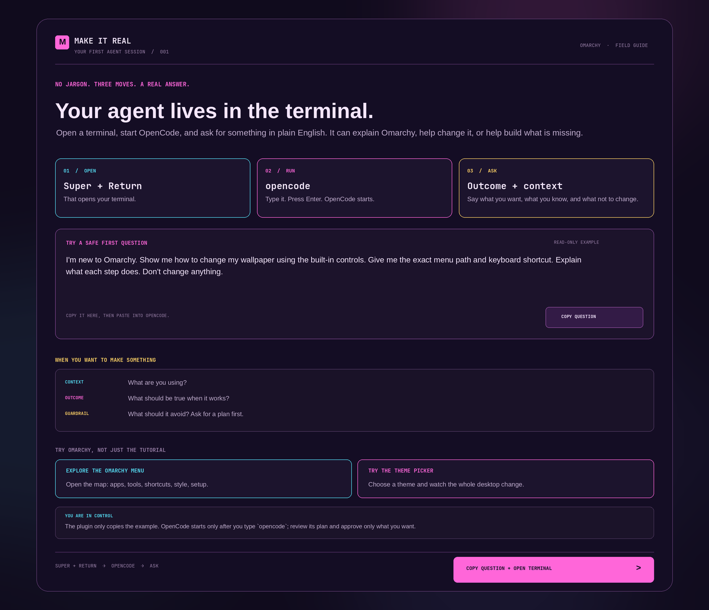

# Make It Real

**Your first OpenCode session, from the terminal to a useful answer.**

Make It Real is an interactive first-run welcome that teaches a new Omarchy
user how to open a terminal, start `opencode`, ask a clear question, and review
the answer. It demonstrates real Omarchy features instead of walking through
generic “Next” screens.



The walkthrough gives the user three concrete steps:

- Open a terminal with `Super + Return` and run `opencode`.
- Ask a safe starter question about using Omarchy's built-in wallpaper controls.
- Learn a reusable request pattern: give context, state the outcome, explain
  constraints, and ask for a plan before approving changes.

It also opens the real Omarchy menu and theme picker so users can explore and
see the desktop respond, and it links out to the four places a new user
eventually needs: [omarchy.org](https://omarchy.org/) for the manual, the
[Discord community](https://omarchy.org/discord), the
[community themes](https://omarchy.org/themes/), and the
[plugin marketplace](https://plugins.omarchy.org). Discord opens through
`omarchy launch discord community`, so an installed Discord app wins over a
browser tab.

The plugin never launches OpenCode or sends a prompt; the user starts the agent
and sends the example themselves.

## Install

Install the public repository and enable the plugin:

```bash
omarchy plugin add https://github.com/signaldirective/first-boot-menu --enable
```

The welcome opens at shell startup until **Do not show again** is enabled or the
user starts the terminal lesson. That preference is stored in
`~/.local/state/omarchy/make-it-real/welcome-mode`. Press **Copy question + open
terminal**, type `opencode`, press Enter, paste the sample question, and send it.
The plugin never sends the prompt to an agent; OpenCode only starts after you
type its command in the terminal.

To see the first-run panel again, remove the preference file and summon the plugin:

```bash
rm ~/.local/state/omarchy/make-it-real/welcome-mode
omarchy shell shell summon io.github.signaldirective.make-it-real '{}'
```

For local development, copy the plugin files into the user plugin directory and
enable it:

```bash
plugin_id=io.github.signaldirective.make-it-real
plugin_dir="${XDG_CONFIG_HOME:-$HOME/.config}/omarchy/plugins/$plugin_id"
mkdir -p "$plugin_dir"
cp manifest.json Panel.qml "$plugin_dir/"
omarchy shell shell rescanPlugins
omarchy plugin enable "$plugin_id"
```

## Reopen the welcome

Run:

```bash
omarchy shell shell summon io.github.signaldirective.make-it-real '{}'
```

Or add this entry to `~/.config/omarchy/extensions/omarchy-menu.jsonc` to make
it available under **Learn** (paste the entry from
[`extras/learn-menu-entry.jsonc`](extras/learn-menu-entry.jsonc) into the
existing object, preserving its other entries):

```jsonc
"learn.make-it-real": {
  "icon": "✳",
  "label": "Make It Real",
  "description": "Ask what your computer could do",
  "action": "omarchy shell shell summon io.github.signaldirective.make-it-real '{}'"
}
```

The plugin does not invoke OpenCode or any AI agent. It copies a fixed,
read-only example question only after the user asks. OpenCode runs in its normal
terminal session, with its usual permissions and approval behavior.

## Security notes

Omarchy shell plugins run as the logged-in user and are not a security sandbox.
This plugin does not use `sudo`, invoke a shell, make network requests, or run
user-provided text as a command. Its fixed-argument helper processes create a
one-word first-run marker and pass the fixed starter question to `wl-copy`
through standard input. Its other launched commands open the terminal, Omarchy
menu, and theme picker; a theme changes only if the user chooses one there. The
plugin never launches an agent. OpenCode has its own permissions and risks; the
starter question requests a read-only answer, but users should still review the
agent's behavior.

## Development

Validate the manifest with:

```bash
omarchy plugin validate .
```

After changing a locally installed plugin, rescan it with:

```bash
omarchy shell shell rescanPlugins
```

## License

MIT. See [LICENSE](LICENSE).
